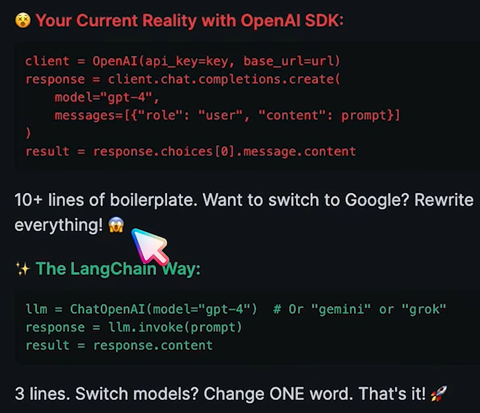
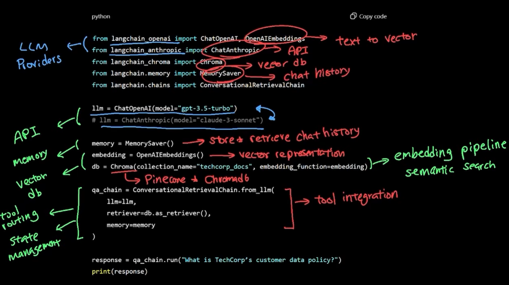

# AI Agents
- AI Fundamentals
    - LLMs are at the heart of most AI agents
    - Popular LLMs include Gemini, Claude, and GPT
        - They are transformer neural networks trained on massive amounts of data
            - Training data can go into the 10s of trillions
            - Training data is from thousands of domains like healthcare, law, coding, science, and more
    - But all that training data does not include company specific internal documents and data
        - Perhaps, a company wants to use a model so that employees can utilize it for internal purposes
            - It needs to be aware of all the company's internal documents and files
        - We could add all of that data into the model's context window by uploading them as files as part of a chat
            - Context window is the model's short term memory of all the chat history and system prompts
                - Allows the model to have context from request to request
                - Context windows are measured in tokens
                    - Upper limit varies
            - Nano, mini, and flash models typically have only a couple thousand token context windows
            - Large mdoels have context windows that range from a couple hundred thousand to a million tokens
            - So choosing the right model for the task is important
                - If you're editing a novel, then use a large model
                - If you're editing a small document, then a mini model would suffice and grant less latency potentially
        - So if we're not uploading everything into the chat at once out of context window limitation, how to do this?
            - The solution is embedding
                - Instead of storing text as words, we convert them into numbers that carry meaning
                - An embedding model takes a text and converts it into a vector that represents the meaning
                    - Each number in our vector represents some feature/ attribute of that token
                - Similar concepts end up with similar number patterns
                    - Ex. Vacation and holidays have similar vectors
                - What this means is that we can find relevant information based on what someone means, not just the exact words they use
                    - Ex. When an employee asks can I wear jeans to work, the model will find the dress code policy, despite the employee not prompting with the word dress. 
                - This is a great way to search a massive set of documents not only for the token efficiency, but for the semantic search capabilities
    - Ex.
        - Techcorp needs a chatbot where customers ask questions about company policy, product information, and support issues
        - The chatbot needs to remember conversation history, access the company knowledgebase, and handle complex multistep interaction
        - A simple chatbot cannot handle all this- we need an agent
    - ChatGPT, Gemini, and Claude and others are like static brains
        - They can answer questions and generate things for us, but they cannot do anything outside their own interface
            - NOTE- This is increasinly changing however, as many are now given tool access to interact with the world and systems
    - An agent contrastly, has autonomy, tools, and memory to perform whatever task it thinks is necessary to complete the request
- Langchain
    - You could write your own implementation of an agent from the group up
    - But there are a number of frameworks that handle this for us
        - Langchain helps build agents with minimal code
            - 
            - There are extensive pre-built components, that handle much of the implementation
                - We just have to select the components and provide the specifics like which model, which vector db, which tools, etc
                -  
                    - Everything in red is what is offered and possible with langchain
                    - Everything in green is what we'd have to implment ourselves without langchain
            - Beyond just what's in the image, langchain offers other tools and components like
                - Web search, custom databases access, local file system access
- Prompt Engineering
    - The quality of your prompt directly impacts the quality of the response you get
        - Agents can handle wide range of prompts, but you can communicate and get the correct prompt more efficiently, with less time and tokens
    - You can also adjust the system prompt which changes overall chatbot behavior
        Ex. You are a company xyz customer support bot. When you're asked about company policy, you always respond in bullet points.
    - There are different techniques for differnt tasks
        - Zero-shot
            - Asking AI to perform a task without an example
            - Rely's on the model's existing knowledge to do something, but it might not come out the way you want
        - One- shot
            - Providing examples and templates with your prompt
        - Chain of thought
            - Provide the model with a trail of steps so it doesn't go off the rail
- Vector databases
    - Gives us a way of storing data by embedding
    - Popular implementations of vector dbs include pinecone and vector db
        - Designed to handle embeddings at scale
    - This is better than a straight sql database because you don’t have to train your llm on how to search your database, you can be confident it can search based on meaning and find the right results
        - Models are designed to understand and handle embeddings, so having a database that stores embeddings make it easy for them to search
            - Searching by meaning means the model can find relevant info despite not having an exact match in words
    - Steps to setup a vector database
        - In a vector database, we need to convert the literal values of our documents into meaning
        - This meaning is represented in vectors containing a list of numbers called embedding
            - Ex. Holiday and vacation should share a similar space, since the meaning is close
        - The embedding model converts the documents into a long vector of numbers via an embedding model
        - So now when someone prompts something, the model can find the relevant documents/ info based on meaning despite not having the same wording
    - Dimensionality
        - Phrases/ info/ text will have different meaning depending on context like tone, formality, and other features
        - Capturing the differences based on those things provide for depth
        - Some models use over 1000 dimensions
            - Meaning every token is seen and represented in 1000 dimensions
        - So embeddings need to be stored with proper dimensions
    - Retrieval
        - Once we’ve stored the meaning of the words, we need to take on the task of retrieving it
        - So now when the model searches it needs to know what is considered a match and by how much
            - Done by looking at scoring and chunk overlap
            - Scoring is a threshold you set to consider how similar a word or meaning should be to get a proper match
            - Chunk overlap
                - When we store text in vector databases, they are often chunked
                    - The meaning can get chunked with it
                    - To resolve this, we do overlapping chunks which will allow for context to spill over
    - So the key here is that while setting up a vector database makes the search more efficient, getting it configured is complex
- Retrieval Augemented Generation (RAG)
    - How RAG and Vector DB are paired togehter
        - RAG is an architectural approach (a way of building an AI system)
        - A vector database is a storage and retrieval technology (a tool that can be used within that architecture)
        - You don't need a vector db to make RAG work
            - You could still use other approaches like sql queries, graph databases, keyword search, etc.
            - Vector DB is often just the best approach for agents
        - You also don't need RAG to make vector dbs work
            - Anytime you want some kind of semeantic search feature like searching for images based on features
    - 3 Components of RAG 
        - Retrieval 
            - Prompts are converted into embeddings and is compared against embeddings of the document
                - Called semantic search because instead of searching by static keywords, we’re searching by meaning and context
        - Augmentation
            - Retrieved data from vector db is injected into the prompt at run time
            - The semantic search result serves as augmented knowledge without having to finetune our model
        - Generation
            - AI assistant generates a response given the semantic search retrieved from the vector database
            - Basically uses the right resource/document as part of its reasoning to best answer the question
    - How to calibrate RAG
        - Varies from system to system
            - Depends on the dataset you’re trying to store
                - Ex. legal docs require different chunking strategies with their long structured paragraphs that need to be conserved and intact than customer support with sentence level chunking
    - So we're supplementing our bot's knoweledge base without fine-tuning the model, which is time and resource intensive
- Langgraph
    - Langchain has limitations when business requirements become more complex
        - Multi step work flows, conditional branching, and iterative processes requires more sophistication
            - Enter langraph- extends langchain to handle complex multistep workflows that go beyond simple question and answer interactions
                - Ex. Maybe it needs access to external systems like Human Resources Mangement Systems
    - So langchain and langraph are not competing frameworks- langraph extends on langchain 
        - LangChain helps you build the individual components of an AI agent: LLM calls, prompts, tools, memory, retrieval, and integrations.
        - LangGraph helps you orchestrate those components into a stateful, multi-step agent that can make decisions, loop, pause, resume, and interact with humans.
            - Provides
                - State: Information shared between workflow steps.
                - Nodes: Individual functions, LLM calls, or agent activities.
                - Edges: Rules determining what happens next.
                - Conditional edges: Decisions about which path to follow.
                - Persistence: Saving execution state so a workflow can resume.
                - Interrupts: Pausing for human approval or input.
- Model Context Protocol (MCP)
    - Custom integrations to external systems would take a long time and is complicated to maintain
    - Functions like an API
        - Traditional APIs expose endpoints that would require you to know implementation details - very specific
    - But MCP exposes tools and provides self describing interfaces that AI agents can understand and use autonomously
        - When you start an MCP server, an instance starts that establishes a connection to your AI agent
    - The key is plug and play
        - Many popular tools have custom mcp servers developed by others, so we don’t need to write our own
    - The models are designed to handle MCP for communication to external services
        - Meaning, they can reach out and communicate to MCP servers, which we build and wrap around our external services
            - Then the MCP server unpacks the model's request and actually peforms the task needed. 
        - So if anything has to change later, it's the MCP server, not the connection between them
            - And generally major services have pre-built MCP servers, so we often don't have to don anything beyond just implemeting the underlying service details
